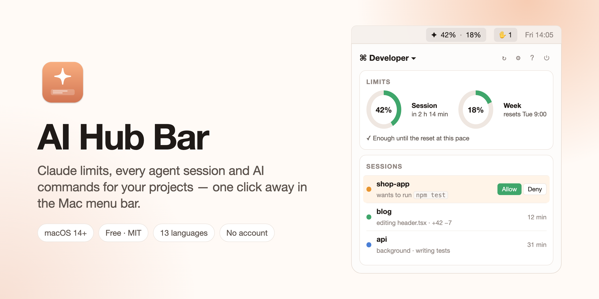

<p align="center">
  
</p>

<p align="center">
  <a href="https://github.com/OlehDemishev/AIHubBar/releases/latest"></a>
  
  
  
  <a href="LICENSE"></a>
</p>

<p align="center">
  <a href="https://github.com/OlehDemishev/AIHubBar/releases/latest"><b>Download</b></a> ·
  <a href="docs/GUIDE.md"><b>Guide</b></a> ·
  <a href="docs/AI-Hub-Bar-Overview-en.pdf"><b>Overview (PDF)</b></a> ·
  <a href="docs/AI-Hub-Bar-Overview-ru.pdf">Обзор на русском (PDF)</a>
</p>

**AI Hub Bar** is a small, native Mac app that lives in the menu bar. One click on ✦ opens a panel with your Claude subscription limits, every Claude Code session running on the Mac, and ready-made AI commands for your projects. It doesn't replace Claude, Codex or any other AI tool — it keeps an eye on them and starts them for you.

Free, open source, no account and no server of its own.

## Features

### Limits — how much is left, and for how long
- Claude's **5-hour session and weekly limits** as rings, with a reset countdown, right in the menu bar.
- A **forecast** from your recent pace: "enough until the reset" or "lasts until ~16:40", and the same for the week.
- **Usage by project** — which project and which session ate the limit today or this week.
- Notifications at the thresholds you choose; near the limit, background runs pause and resume after the reset.
- **Other AI services** appear by themselves: Codex, GitHub Copilot, Gemini CLI, Cursor, OpenRouter credits, OpenAI and Anthropic API spend.

### Every Claude Code session in one list
- Terminal, the Claude app, background runs: state, task, duration — and **what Claude is doing right now** ("editing LimitsView.swift", "running npm test").
- **Allow / Deny** permission requests from the notification, the panel or Telegram.
- Context fullness, files changed since the session started, and a heads-up when a session goes quiet.
- **Background runs** under an explicit permission list (no push to main, no force push, no deleting, no reading secrets), a night queue and a morning summary.

### Projects and AI commands — not only for developers
Profiles built from modules, each with its own panel and menu bar. Start from a template:

| Template | A project is | Commands, for example |
|---|---|---|
| Developer | a git repository | Next step, Custom task, Finish (checks, commit, push, PR) |
| Video | a folder per video | hooks, a Shorts version, description with timestamps, titles |
| Writing | a folder per text | edit, proofread, another tone, SEO, split into posts |
| Research | a folder per topic | source summary, quotes with references, overview table |
| Social media | a campaign or platform | posts per platform, ad variants, a week's content plan |
| Custom | any folder | your own, with `{project}`, `{file}`, `{language}` … |

A command's result is always a **new file** — nothing is overwritten. **Compare** runs one command with two or three services side by side. Works with Claude Code, Codex CLI, Gemini CLI, Antigravity, Copilot CLI, Cursor CLI, and models by API (Anthropic, OpenAI, Google, xAI, DeepSeek, Mistral, Ollama, LM Studio, OpenRouter).

### And more
- **Calendar** of deadlines, publications and content plans straight from your project files — drag an entry and the file is updated.
- **Mac tools** as optional modules: Mac Resources, Keep Awake, Quick Commands, Quick Toggles, Clipboard History, Notes.
- **⌃⌥C search** from any app, **widgets**, a **Control Center** toggle, **Shortcuts** actions, **Telegram** alerts and a weekly summary.
- **13 languages**: English, Русский, Українська, Español, Português (Brasil), Français, Deutsch, Italiano, Polski, 日本語, 한국어, Bahasa Indonesia, العربية.

## Install

1. Download `AIHubBar-<version>.dmg` from [Releases](https://github.com/OlehDemishev/AIHubBar/releases/latest).
2. Open it and drag **AI Hub Bar** to Applications.
3. Open the app. macOS says it can't check the developer (the app isn't signed with an Apple Developer ID) — close the message.
4. System Settings → Privacy & Security → **Open Anyway**.

You only do this once; after that the app updates itself (Settings → General → Updates). The first start opens an assistant that checks what the Mac still needs and sets up your first profile. Everything else is in the [guide](docs/GUIDE.md).

**Requirements:** macOS 14 or later (Apple Silicon or Intel) and at least one AI service — Claude Code with a Claude subscription, another agent, or an API key. The limits and the session list need Claude Code.

## Privacy

- No server, no account, no analytics. AI Hub Bar talks only to the AI services you use.
- Your files go only to the service you run a command with.
- API keys are kept in the macOS Keychain, never in logs or exported settings. Claude Code's sign-in is read from the Keychain on each refresh and never stored.
- The session hook only writes small status files on your Mac and never changes what Claude does; Settings → Claude Code → Remove hooks takes it out.

## Build from source

```bash
brew install xcodegen
scripts/build-and-install.sh          # --test runs the unit tests first
```

Needs Xcode with Swift 6. The project is generated from `project.yml`; SwiftUI, Swift concurrency, Sparkle for updates. Releases: [docs/RELEASE.md](docs/RELEASE.md).

## Documentation

- [Guide](docs/GUIDE.md) — install, first start, everyday use, privacy, troubleshooting, uninstall
- [Overview PDF](docs/AI-Hub-Bar-Overview-en.pdf) · [на русском](docs/AI-Hub-Bar-Overview-ru.pdf)
- [Reference](docs/REFERENCE.md) — every feature in detail, background mode rules, session hooks, command line
- [Specification](docs/SPEC.md) · [Decisions](DECISIONS.md) · [Status](docs/STATUS.md)

> AI Hub Bar was called **ClaudePult** until October 2026; the bundle id, the Xcode project and the data folders keep the old name.

## License

[MIT](LICENSE). AI Hub Bar is an independent project and is not affiliated with Anthropic, OpenAI, Google or GitHub.
